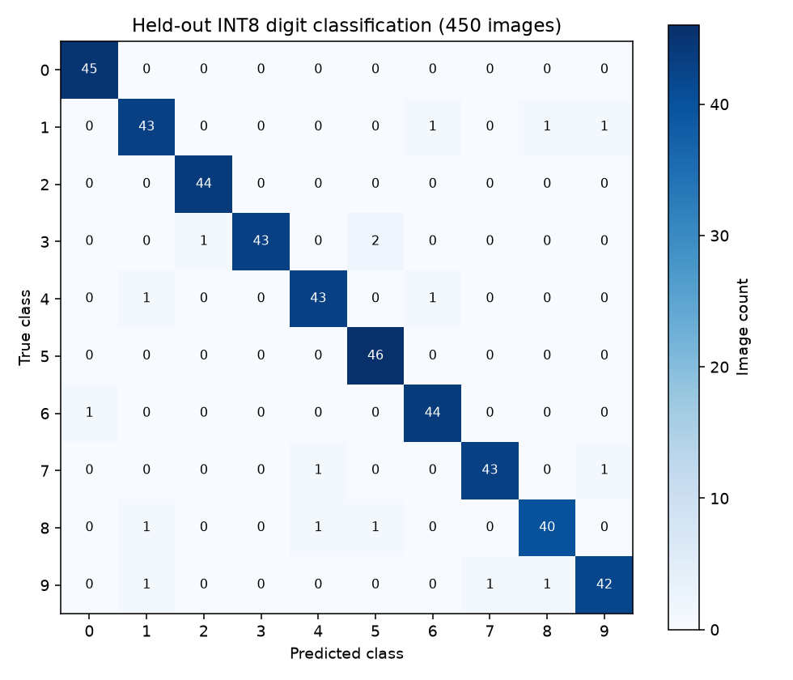

# Verified local experiment

Executed 2026-10-26 on macOS ARM64, Python 3.12, PyTorch 2.10.0, CPU only.

| Measure | Result |
| --- | ---: |
| Real digit images | 1,797 |
| Train / validation / held-out test | 1,077 / 270 / 450 |
| Training epochs / checkpoint selected by validation | 35 / 23 |
| PyTorch FP32 held-out accuracy | 96.22% |
| Weight-only INT8 held-out accuracy | 96.22% |
| Logistic-regression held-out accuracy | 96.67% |
| PCA + SVM held-out accuracy | 98.89% |
| FP32 / INT8 prediction agreement | 100% |
| FP32 parameter bytes | 68,904 |
| INT8 parameters plus scales/biases | 18,640 bytes |
| Parameter storage reduction | 72.95% |
| Quantized model file including headers | 18,672 bytes |
| C++ / NumPy maximum quantized logit difference | 0.000003343 |
| C++ / NumPy prediction agreement | 100% |
| Local C++ batch-amortized inference time | 0.00562 ms/image |
| Constructed video frames / unique source images | 120 / 30 |
| Constructed-clip accuracy | 96.67% |
| Unit/runtime tests passed | 21 |

The classical PCA+SVM baseline outperformed this small neural network. Quantization
preserved its predictions on this test split, but that is not guaranteed on other
inputs. Storage excludes framework/process overhead and activations. Runtime is a
local CPU measurement, not an Android/edge-device benchmark or a demonstrated
speedup. Video frames repeat held-out still images; no natural-video performance
or temporal generalization is established. The C++ real-model path and malformed-
artifact tests passed under ASan/UBSan. No device deployment was performed.
